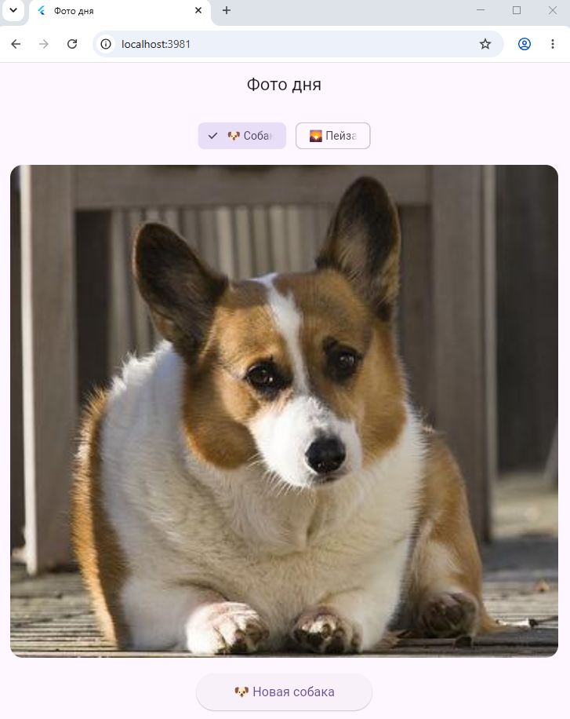

# Приложение "Фото дня"
Приложение "Фото дня" позволяет загружать случайные фотографии собак и пейзажей из интернета. Пользователь может выбирать тип изображения и загружать случайное фото с помощью кнопки.

## Автор
**Имя:** Ульяна
**Группа:** ИСП-241

## Стек и версии
Flutter версия: 3.47.8
Dart версия: 3.13.7
платформа: Web (Chrome)
пакет: http

## Скриншот приложения

## Запуск
1.	`git clone <url>`
2.	`cd photo_of_the_day`
3.	`flutter pub get`
4.	`flutter run -d chrome`

## Что изучено
- Использование `Future` для работы с асинхронными операциями.
- Обработка ошибок с помощью `try/catch`.
- Применение `async` и `await` для последовательного выполнения асинхронного кода.
- Выполнение HTTP-запросов с помощью пакета http.

## Ответы на вопросы
1. Что такое `Future<T>`? Чем отличается от обычного возвращаемого значения?
`Future<T>` - объект, который обещает вернуть значение типа `T` в будущем. В отличии от обычного возвращаемого значения результат `Future` появляется не сразу, а после завершения асинхронной операции.

2. Что делает `await`? Блокирует ли он весь поток выполнения?
`await` приостанавливает выполнение текущей функции до завершения `Future`, после чего выполнение продолжается. Он не блокирует поток, другие части программы продолжают работать.

3. Зачем `setState()` вызывается дважды в `_fetchPhoto()`?
Первый вызов `setState()` устанавливает состояние загрузки и сбрасывает предыдущий результат чтобы показать индикатор загрузки. Второй вызов выполняется после получения результата и скрывает индикатор загрузки.

4. Почему кнопке передаётся `_fetchPhoto` без скобок, а не `_fetchPhoto()`?
`_fetchPhoto` передаёт ссылку на функцию, чтобы она вызывалась при нажатии кнопки, Если написать `_fetchPhoto()`, то функция выполнится сразу при построении виджета.

5. Чем `Image.network()` отличается от `Image.asset()`?
`Image.network()` загружает и отображает изображение по URL из интернета. `Image.asset()` отображает изображение, которое хранится в ресурсах проекта в папке assets.